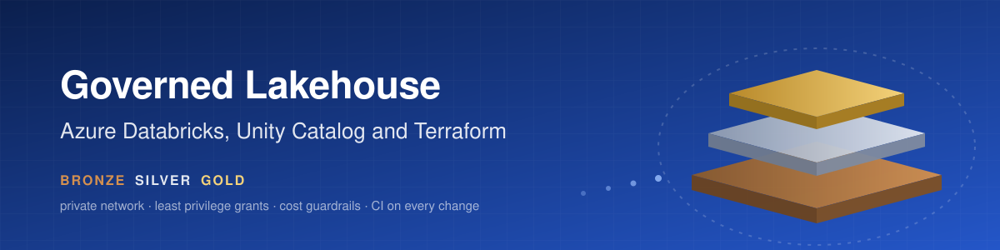
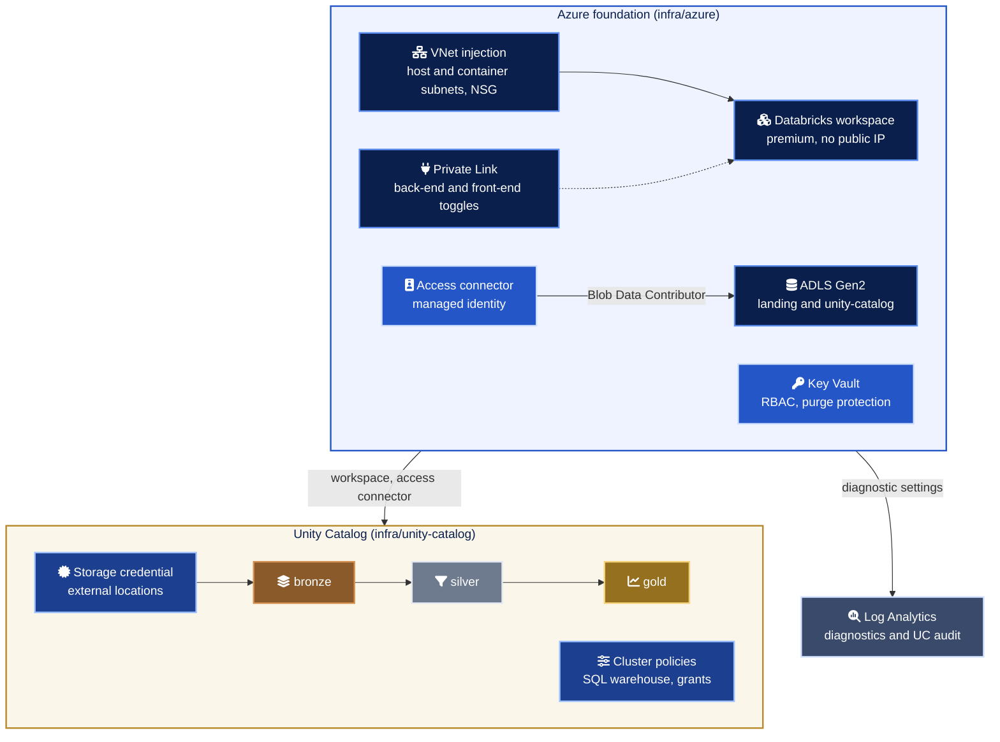
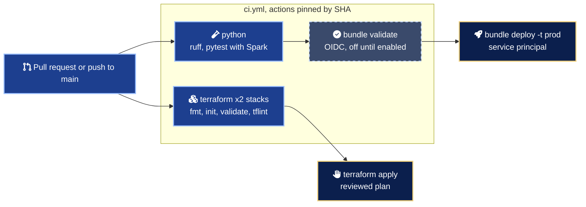

<div align="center">



# databricks-lakehouse-terraform

A governed enterprise lakehouse on Azure Databricks, from private network to gold table, declared end to end in code.

<a href="https://www.databricks.com/product/unity-catalog"></a>
<a href="https://developer.hashicorp.com/terraform"></a>
<a href="https://registry.terraform.io/providers/hashicorp/azurerm/latest"></a>
<a href="https://spark.apache.org/"></a>
<a href="https://www.python.org/"></a>

</div>

## In numbers

| Measure | Count | Where it comes from |
| --- | --- | --- |
| Terraform resource blocks | 44 | 25 in `infra/azure`, 19 in `infra/unity-catalog` |
| Catalogs and schemas | 3 and 9 | `dev`, `test`, `prod`, each with `bronze`, `silver`, `gold` |
| Account groups with least privilege grants | 3 | `platform_admins`, `data_engineers`, `data_analysts` |
| Cluster policies | 2 | Job compute and small interactive, both with forced cost tags |
| Diagnostic settings | 3 | Workspace, ADLS blob service and Key Vault into Log Analytics |
| Optional private endpoints | 3 | Back-end, front-end and browser authentication |
| Silver data quality expectations | 4 | One dictionary shared by the pipeline and the tests |
| Test cases | 45 | 43 pure Python, 2 Spark (run in CI, skipped without a JDK) |
| CI jobs | 3 | Terraform matrix, Python, gated bundle validation |
| Architecture decision records | 3 | `docs/adr` |

## What it is

A reference implementation of the platform a data team needs before its first production table. It deploys an Azure Databricks workspace into a private network, wires Unity Catalog to ADLS Gen2 through a managed identity, and lays out one catalog per environment with grants that follow least privilege. On top of it, an asset bundle ships a medallion pipeline for IoT sensor telemetry, with expectations, a schedule, alerts and tests that run in under a second.

Everything is reproducible from this repository. There are no keys, no secrets and no click-ops steps.

## Architecture



## How the data flows

```mermaid
flowchart LR
    classDef src fill:#0b1f4d,stroke:#5b8def,color:#ffffff,stroke-width:2px
    classDef bronze fill:#8a5a2b,stroke:#d4904f,color:#ffffff,stroke-width:2px
    classDef silver fill:#6e7a8e,stroke:#e3e8f0,color:#ffffff,stroke-width:2px
    classDef gold fill:#94701f,stroke:#f4d27a,color:#ffffff,stroke-width:2px
    classDef ops fill:#2456c8,stroke:#cfe0ff,color:#ffffff,stroke-width:2px

    CSV["fa:fa-file-csv Sensor CSV files<br/>landing/sensor_telemetry"]:::src
    AL["fa:fa-download Auto Loader<br/>incremental, schema rescue"]:::src
    B["fa:fa-layer-group bronze.sensor_readings_raw<br/>as received, change data feed"]:::bronze
    E{"fa:fa-check-double 4 expectations<br/>drop and count"}:::silver
    S["fa:fa-filter silver.sensor_readings<br/>typed, Celsius, deduplicated"]:::silver
    G["fa:fa-chart-line gold.sensor_hourly_stats<br/>per device and hour, anomalies"]:::gold
    W["fa:fa-table SQL warehouse<br/>data_analysts"]:::gold
    F["fa:fa-stopwatch Freshness check<br/>job compute policy"]:::ops
    M["fa:fa-envelope Failure and duration alerts"]:::ops

    CSV --> AL --> B --> E --> S --> G --> W
    G --> F
    F -- "stale" --> M
```



The sample file `bundles/sensor_telemetry/fixtures/sensor_readings_sample.csv` carries 31 readings from three sensors, one of them reporting Fahrenheit. Five rows are defective on purpose (missing device, unparseable timestamp, temperature outside the sensor range, humidity above 100 percent, unknown unit) and one is a duplicate. The tests assert that silver keeps 25 readings and gold produces 6 hourly rows with exactly one anomaly.

## Environments

| | `dev` | `test` | `prod` |
| --- | --- | --- | --- |
| Catalog | `lakehouse_dev` | `lakehouse_test` | `lakehouse_prod` |
| Engineers | Write | Read | Read |
| Analysts | No access | Gold only | Gold only |
| Writer identity | The developer | Pipeline service principal | Pipeline service principal |
| Bundle target | `dev`, development mode | Pattern documented | `prod`, production mode |
| Schedule | Paused | Paused | Hourly |
| Lake replication | LRS | LRS | ZRS |

## Quick start

Run the checks locally. No cloud account needed.

```bash
git clone https://github.com/marlyngiselle/databricks-lakehouse-terraform.git
cd databricks-lakehouse-terraform
python3 -m venv .venv
.venv/bin/pip install -e ".[dev]"
.venv/bin/ruff check . && .venv/bin/pytest
terraform -chdir=infra/azure init -backend=false && terraform -chdir=infra/azure validate
terraform -chdir=infra/unity-catalog init -backend=false && terraform -chdir=infra/unity-catalog validate
```

Deploy the Azure foundation (after `az login`).

```bash
cp infra/azure/terraform.tfvars.example infra/azure/terraform.tfvars
terraform -chdir=infra/azure init
terraform -chdir=infra/azure apply
```

Deploy governance, wired to the outputs of the first stack. `databricks_account_id` and `metastore_id` are set in `terraform.tfvars`.

```bash
cp infra/unity-catalog/terraform.tfvars.example infra/unity-catalog/terraform.tfvars
export TF_VAR_workspace_url="$(terraform -chdir=infra/azure output -raw workspace_url)"
export TF_VAR_workspace_id="$(terraform -chdir=infra/azure output -raw workspace_id)"
export TF_VAR_access_connector_id="$(terraform -chdir=infra/azure output -raw access_connector_id)"
export TF_VAR_storage_account_name="$(terraform -chdir=infra/azure output -raw storage_account_name)"
terraform -chdir=infra/unity-catalog init
terraform -chdir=infra/unity-catalog apply
```

Land the sample file and run the pipeline in dev.

```bash
az storage blob upload --auth-mode login \
  --account-name "$(terraform -chdir=infra/azure output -raw storage_account_name)" \
  --container-name landing --name sensor_telemetry/sensor_readings_sample.csv \
  --file bundles/sensor_telemetry/fixtures/sensor_readings_sample.csv
cd bundles/sensor_telemetry
export DATABRICKS_HOST="$(terraform -chdir=../../infra/azure output -raw workspace_url)"
databricks bundle deploy -t dev \
  --var="landing_path=$(terraform -chdir=../../infra/unity-catalog output -raw landing_url)sensor_telemetry" \
  --var="job_policy_id=$(terraform -chdir=../../infra/unity-catalog output -raw job_compute_policy_id)"
databricks bundle run -t dev sensor_telemetry
```

## Access model

| Who | dev | test and prod | Compute |
| --- | --- | --- | --- |
| `platform_admins` | Owner of every securable | Owner of every securable | Manage the SQL warehouse |
| `data_engineers` | Build (write set) | Read everything | Both cluster policies, SQL warehouse |
| `data_analysts` | None | `SELECT` on `gold` | SQL warehouse |
| Pipeline service principal | None | Write (write set) | Job compute policy |

The full matrix, securable by securable, is in [docs/governance.md](docs/governance.md).

## Delivery



Every check runs on every pull request. Applying infrastructure and deploying to prod stay deliberate steps.

## Before you touch anything

> [!WARNING]
> The storage and Key Vault firewalls default to `Deny`. The machine or runner that applies `infra/azure` must be listed in `allowed_ip_ranges`, or container creation fails with a 403 after the account already exists.

> [!CAUTION]
> `databricks_grants` is authoritative. Any privilege granted by hand on a catalog, schema or external location managed here is revoked on the next apply.

> [!IMPORTANT]
> Newer Databricks accounts attach workspaces to the regional metastore automatically. If the workspace already shows a metastore, set `assign_metastore = false` instead of fighting the assignment.

> [!WARNING]
> Front-end Private Link turns off public access to the workspace. CI runners and users then need a network path to the private endpoint, and the stack refuses the setting unless back-end Private Link is on too.

> [!NOTE]
> The workspace, the lake account, its containers and the Key Vault carry `prevent_destroy`, and the Key Vault has purge protection. `terraform destroy` stops on them by design, and a deleted vault name stays reserved for 90 days.

## Repository map

| Path | What it holds |
| --- | --- |
| `infra/azure/` | Network, workspace, Private Link, ADLS Gen2, access connector, Key Vault, Log Analytics |
| `infra/unity-catalog/` | Groups, metastore assignment, storage credential, external locations, catalogs, schemas, grants, cluster policies, SQL warehouse |
| `bundles/sensor_telemetry/databricks.yml` | Bundle definition, variables and the `dev` and `prod` targets |
| `bundles/sensor_telemetry/resources/` | Pipeline and job, with schedule, alerts and health rules |
| `bundles/sensor_telemetry/src/pipelines/` | Bronze, silver and gold pipeline definitions |
| `bundles/sensor_telemetry/src/sensor_telemetry/` | Pure Python rules and their Spark twins |
| `bundles/sensor_telemetry/src/jobs/` | Freshness check that fails the job when gold is stale |
| `bundles/sensor_telemetry/fixtures/` | Synthetic sensor CSV with deliberate defects |
| `tests/` | Unit, end to end sample, Spark and bundle configuration tests |
| `docs/` | Architecture, governance, promotion, cost controls and ADRs |
| `.github/workflows/ci.yml` | CI for both stacks, the Python code and the bundle |

## Documentation

| Document | What it answers |
| --- | --- |
| [Architecture](docs/architecture.md) | How the network, identity, storage and diagnostics fit together |
| [Governance model](docs/governance.md) | Who can read and write what, and why, securable by securable |
| [Environment promotion](docs/environment-promotion.md) | How code moves from dev to prod and what changes between targets |
| [Cost controls](docs/cost-controls.md) | Cluster policies, auto-termination, forced tags and where to read the bill |
| [ADR 0001](docs/adr/0001-vnet-injection-with-secure-cluster-connectivity.md) | Why VNet injection with secure cluster connectivity from day one |
| [ADR 0002](docs/adr/0002-one-catalog-per-environment.md) | Why one catalog per environment in a shared metastore |
| [ADR 0003](docs/adr/0003-declarative-pipeline-with-pure-python-core.md) | Why a declarative pipeline over a pure Python core |

<div align="center">
<br>
<sub>Built by Giselle Da Costa · Cloud and data platform architecture · MIT licensed</sub>
</div>
