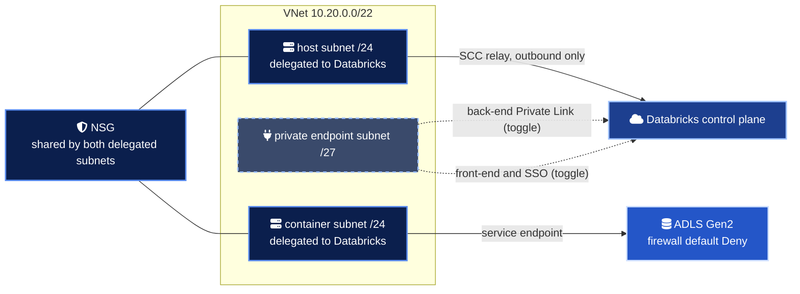

# Architecture

The platform is built in three layers, each owned by its own tool and its own state.

| Layer | Path | Tool | Owns |
| --- | --- | --- | --- |
| Azure foundation | `infra/azure` | Terraform, `azurerm` 4.x | Network, workspace, storage, identity, Key Vault, diagnostics |
| Governance | `infra/unity-catalog` | Terraform, `databricks` provider | Groups, metastore assignment, credentials, catalogs, schemas, grants, policies, SQL warehouse |
| Workloads | `bundles/sensor_telemetry` | Databricks Asset Bundles | Pipeline, job, schedule, alerts |

Splitting the stacks keeps the blast radius small. A grant change never plans against the VNet, and a pipeline release never needs Terraform credentials.

## Network

| Setting | Value | Why |
| --- | --- | --- |
| `no_public_ip` | `true` | Secure cluster connectivity. Nodes have no public address and open no inbound ports |
| Subnet delegation | `Microsoft.Databricks/workspaces` | Required for VNet injection; Databricks manages the NSG rules it needs |
| `network_security_group_rules_required` | `AllRules`, or `NoAzureDatabricksRules` with back-end Private Link | Without Private Link the control plane needs its service tag rules |
| `public_network_access_enabled` | `false` only with front-end Private Link | A precondition refuses a closed front-end with an open back-end |
| Storage firewall | `Deny`, with the two delegated subnets and the access connector as exceptions | The lake is never reachable from the internet |

## Identity

Unity Catalog reaches storage through an Azure Databricks access connector with a system-assigned managed identity. The identity holds `Storage Blob Data Contributor` on the lake account and nothing else. There is no storage key, no SAS and no service principal secret anywhere in the platform. Shared key access is disabled on the account and the `azurerm` provider talks to the data plane with Entra ID.

## Storage layout

| Container | Path | Purpose |
| --- | --- | --- |
| `unity-catalog` | `/dev`, `/test`, `/prod` | Managed storage root of each catalog, one external location per environment |
| `landing` | `/sensor_telemetry` | Files dropped by producers and read by Auto Loader |

Tables never live in `landing`, and producers never write into `unity-catalog`. The split keeps raw files and governed tables under different grants.

## Observability

Every stateful resource ships its logs to one Log Analytics workspace.

| Source | Categories |
| --- | --- |
| Databricks workspace | `accounts`, `clusters`, `jobs`, `notebook`, `secrets`, `sqlPermissions`, `unityCatalog`, `workspace`, `deltaPipelines`, `databrickssql` |
| ADLS blob service | `StorageRead`, `StorageWrite`, `StorageDelete`, `Transaction` metrics |
| Key Vault | `audit` category group, all metrics |

The `unityCatalog` category is the one auditors ask for. It records every grant change and every table access, by principal.
