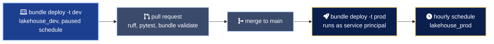

# Environment promotion

Infrastructure and workloads move through environments by different paths, and on purpose.

| What | Moves by | Gate |
| --- | --- | --- |
| Azure foundation | One `infra/azure` state per environment, selected with its own `terraform.tfvars` | Pull request plus a reviewed plan |
| Governance | One `infra/unity-catalog` state for all catalogs | Pull request plus a reviewed plan |
| Pipeline and job | Bundle targets `dev` and `prod` | CI green on `main`, then `bundle deploy -t prod` |

## Workload path

## What changes between targets

| Setting | `dev` | `prod` |
| --- | --- | --- |
| Bundle mode | `development`, resources prefixed with the developer name and schedules paused | `production`, one shared copy with schedules as declared |
| Catalog | `lakehouse_dev` | `lakehouse_prod` |
| Identity | The developer | Pipeline service principal (`run_as`) |
| Schedule | `PAUSED` | `UNPAUSED`, hourly at minute 5 |
| Workspace path | User home | `/Workspace/Shared/.bundle/sensor_telemetry/prod` |
| Permissions | Developer only | `platform_admins` manage, `data_engineers` view |

## The test catalog

`lakehouse_test` exists in the governance stack so integration runs never touch prod data. Adding a `test` target to the bundle is a copy of the `prod` block with `catalog: lakehouse_test` and the schedule left paused; it is kept out of this example to stay readable.

## Rules

1. Code is promoted, data is not. Each environment ingests from its own landing path.
2. Nobody deploys to prod from a laptop. The prod target runs as a service principal, and the identity that deploys it should be the CI workflow.
3. A failing freshness check fails the job, which fires the failure alert. Silence is never the healthy state.
